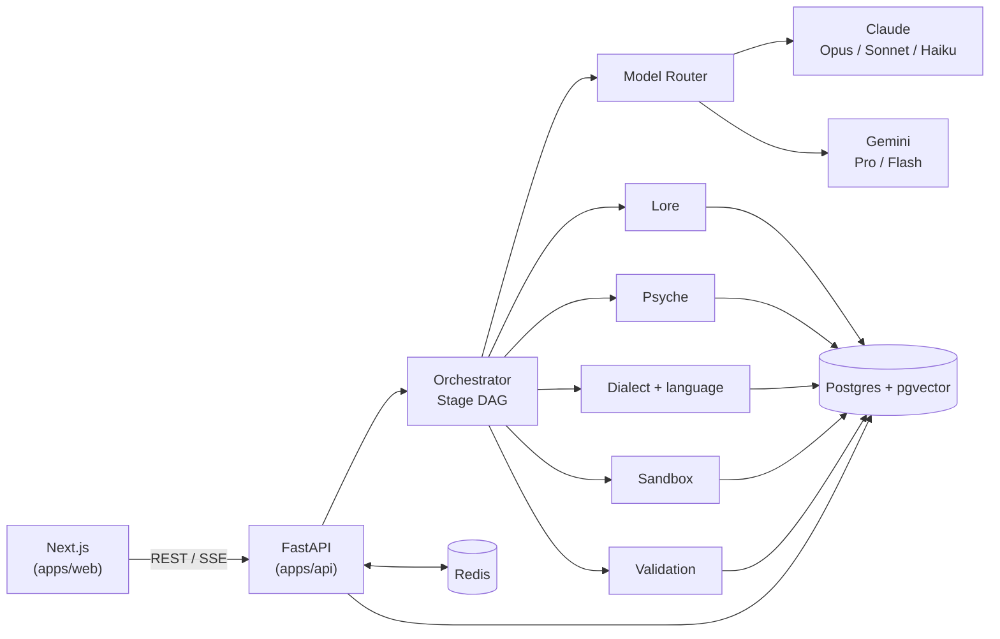

# ChronicleDeck

> Fiction authors lose track of their own world as a story grows, and AI writing tools make it worse by inventing contradictions with total confidence. ChronicleDeck treats the story bible as typed, versioned canon and checks every chapter against it, with evidence.

**Status: pre-build.** The app shell, data model, auth/CRUD API and eight mock screens exist. The generation pipeline, engines, prompts and evals are built during the live window. [PREBUILT.md](PREBUILT.md) lists exactly what is where.

---

## ❓ Problem Statement

**Problem:** Long-form fiction (novels, series, screenplays, game lore) accumulates thousands of facts: who is dead, who knows what, what a character would never do, how a faction talks, which words exist in an invented language. Authors keep these in their heads or scattered notes. LLM co-writers have no durable memory of them, so they quietly break canon: a dead character acts, a sworn enemy turns warm for no reason, a constructed language grows words that were never defined. Today the author finds these by rereading, usually after readers do.

**Why it matters:**
- Continuity errors are the most common reason a long draft needs a costly rewrite.
- Generic LLM output is fluent enough that the errors are easy to miss and hard to trace back.
- Authors will not adopt a tool that blocks their writing, buries them in JSON, or flags things it can't justify.

**Track:** Storytelling & Co-Writers

---

## 💡 Proposed Solution

**Solution:** A narrative intelligence studio that works in any genre, any universe and any invented language. Authors write (or co-write with the model) in an editor; every chapter is checked against their canon, and each warning points to the exact text and the exact canon it conflicts with.

**Key idea:** **Canon as code.** The story bible is typed, versioned data (entities, facts, rules, psychology, dialect, lexicon, per-branch state). Generated text is *linted* against it the way source code is linted: claims are extracted, checked by deterministic code where possible and by a different model family where not, and every flag must carry quoted evidence that is verified in code before the author ever sees it. Generated content can only create *proposals*; nothing becomes canon until the author approves it.

**Why this works:**
- **Evidence or it doesn't ship.** A flag with no evidence, or whose quotes don't match their sources exactly, is dropped. This is what keeps the lint trustworthy enough to leave on.
- **Deterministic where possible.** Closed-lexicon conlang checks, timeline rules, psychology transition limits and NPC knowledge scoping are code, so they can't hallucinate and can be tested.
- **Cross-family judging.** Claude writes, Gemini judges, so the judge doesn't share the generator's blind spots.
- **Branches stay separate.** Every fork is its own timeline with its own snapshots, so "what if" comparisons are a diff, not a guess.
- **Flag, never block.** Authors keep control: strictness changes what is surfaced, one click marks a flag *Intentional*, and that choice is remembered.

---

## 🧩 Approach & Architecture

### System



### Per-scene pipeline

```
assemble_working_memory (5 slots)
  └─► plan_beats ─► validate_plan (canon refs exist, motives fit psyche, NPC knowledge scope)
        └─► generate (stream) ─► dialect_transduce
              └─► extract_claims ─┬─► lore_check
                                  ├─► psyche_check
                                  ├─► language_gate        ─► verify_evidence ─► aggregate
                                  └─► voice_check                                  └─► repair(spans) ≤2
                                                                                        └─► propose_canon ─► author_review ─► commit
```

Every stage validates its input and output schema, retries with the error fed back, post-validates semantically in code, and logs a trace (tokens per memory slot, cache hits, latency, cost).

### Memory: five types

| Type | Stores | Retrieval |
|---|---|---|
| **Global** | World rules, history, geography, languages | Cached canon prefix |
| **Character** | Psyche, relationships, voice/dialect | Entities named in the plan |
| **Branch** | Choices and state per timeline | Ancestry via recursive CTE |
| **Episodic** | Past events and summaries (saga → arc → chapter → scene) | Top-down vector search |
| **Working** | The context for one call | Built fresh, with a token budget per slot |

### Four engines

| Engine | What it does | How |
|---|---|---|
| **Lore** | Canon compiler, branch-scoped truth, timeline checks | Opus compiles notes into proposals; code enforces "dead characters can't act", "one place per scene" |
| **Psyche** | Keeps characters in character | Transition rules in code (e.g. trust can't jump more than 0.3 per chapter without a declared major event); judge with evidence |
| **Dialect + language** | Per-character voice and invented languages | Deterministic rewrite-rule transducer; closed lexicon, so any unknown conlang word is a hard flag; phonotactics FSM validates new words |
| **Sandbox** | NPCs that respect the world | Spawner anchors backstory to existing IDs; knowledge scoping flags "knowledge leaks" |

### Ten hallucination defences (each one measured)

| # | Defence | Enforced by |
|---|---|---|
| 1 | Plan before prose | New elements must be declared up front |
| 2 | Reference integrity | Every canon ref checked against the DB |
| 3 | Claim extraction | Prose broken into atomic claims |
| 4 | Cross-family judge | Claude generates, Gemini judges |
| 5 | Evidence required | Flags without evidence are dropped |
| 6 | Exact-quote verification | Trigger and evidence quotes must match their sources exactly, checked in code |
| 7 | Deterministic gates | Conlang, timeline, psyche delta, knowledge scope |
| 8 | Span-level repair | At most 2 tries, then handed to the author |
| 9 | Canon ledger | Generated content only creates proposals |
| 10 | Exception memory | "Intentional" becomes a stored exception rule |

### Branching and What-if

Fork any chapter into a new timeline. Compare two branches side by side: a world diff, a relationship grid sorted by divergence, and overlaid psychology arcs with the fork marked. Every row links back to the chapter where the change happened.

### Author experience

No JSON or prompts in the UI, no blocking modals, a three-level strictness control, and **Fix / Intentional / Change rule** on every flag. Write-first onboarding: dump any notes or a manuscript and approve the resulting bible cards one at a time.

---

## 📁 Project Structure

```
apps/web/       Next.js 15 + Tailwind. 8 screens, mock data
apps/api/       FastAPI, SQLAlchemy 2 (async), Alembic migrations, auth, CRUD
pipeline/       Stage contract, model router, stages, prompts          ← built live
engines/        lore · psyche · dialect · language · sandbox           ← built live
memory/         memory tree, retriever, branch ancestry                ← built live
universes/      seed universes                                         ← built live (needs confirmation)
evals/          eval suites + harness                                  ← built live
tests/          unit (pre-built) · integration · e2e
docs/           architecture, memory model, ADRs, demo script, user guide
infra/          docker-compose + Dockerfiles
.github/        CI workflow
PREBUILT.md     every file committed before the live window
```

The eight screens: **New Story** · **Story Bible** · **Editor** (Watch / Co-write / Draft, evidence cards) · **Screenplay** (Fountain) · **Story Map** · **What-if Explorer** · **Proposals inbox** · **Health & cost**.

---

## 🚀 How to Run

Python work happens in a project-local virtual environment.

```bash
python -m venv .venv
# Windows PowerShell: .\.venv\Scripts\Activate.ps1      macOS/Linux: source .venv/bin/activate
pip install -e ".[dev]"
npm --prefix apps/web install
cp .env.example .env
```

**Run the checks** (no database needed):

```bash
pytest && ruff check . && mypy
npm --prefix apps/web run lint && npm --prefix apps/web run typecheck
```

**Run the UI** (uses mock data, no backend needed):

```bash
npm --prefix apps/web run dev        # http://localhost:3000
```

**Run the full stack** (needs Docker):

```bash
make dev                             # db + redis + api + worker + web
```

Or run Postgres and Redis in Docker and the apps on the host: `make dev-deps`, `make migrate`, `make api`, `make web`. `make` is optional; each target is a one-line command you can paste.

**API docs:** `http://localhost:8000/docs`. Routes tagged `live-build` return `501` until they are built.

> `make eval`, `make seed` and `make demo` intentionally exit with a "built live" message in the pre-build.

---

## Planned Stack

| Layer | Technology | Why |
|---|---|---|
| Framework (web) | Next.js 15 (App Router), TypeScript, Tailwind, shadcn-style UI | Fast to build, server rendering, consistent components |
| Framework (api) | FastAPI, Python 3.12, Pydantic v2 | Async, schemas double as structured-output contracts |
| Editor / viz | TipTap (inline lint decorations), React Flow (branch map), Recharts | Squiggles and gloss tooltips in the text; DAG and charts |
| Database | Postgres 16 + pgvector | Relational canon and vector memory in one store, with branch-filtered search |
| Jobs / realtime | Arq + Redis, Server-Sent Events | Background compile/embed/audit; streaming generation |
| Generation | Claude Opus 5.5 / Sonnet 5.5 / Haiku 5.5 | Heavy reasoning, prose and dialogue, cheap utility calls; prompt caching on the canon prefix |
| Judging | Gemini Pro (verdicts), Gemini Flash (claim extraction) | A different model family from the generator |
| Auth | Email + password (scrypt) with JWT | Simple and sufficient; built into the pre-built API |
| Hosting | Vercel (web), Railway (api, worker), Neon (Postgres), Upstash or Railway Redis | Quick public URL |
| Observability | Langfuse + structlog | Traces, cost, tokens per memory slot |
| Quality | ruff, mypy (strict), ESLint, pytest, Hypothesis, GitHub Actions | Typed, tested, CI-gated |

---

## What We'll be Building Toward

**Already in the repo (pre-build):** app shell and 8 mock screens; TipTap lint-decoration hook; typed schema and migration for 22 tables including a pgvector index; auth and CRUD; the full route contract for the live endpoints (declared, returning 501); Docker, CI, docs and ADRs.

**Built live :**

 Model router and adapters, Stage contract, tracing, claim and verdict prompts, psyche transition rules, canon compiler, lore check, exact-quote verifier, conlang gate 
 Memory tree and working-memory slots, Gemini judges and evidence gate, dialect transducer, streaming editor with live lint, planner and generator with caching, repair loop, NPC spawner, evidence cards 
 Forking, snapshots and deltas, proposals and exceptions, voice judge and screenplay register, compare API and What-if, sandbox tick, cost panel with real data, eval runs, hardening, deploy 

**Evaluation plan.** 2–3 universes × 10 chapters × 2 branches with about 25 planted errors each (lore, psychology, timeline, voice, language, knowledge leak). Compare (A) raw Claude with all lore pasted in, (B) the pipeline with Claude judging Claude, and (C) the pipeline with Gemini judging Claude, plus ablations if time allows. Metrics: recall and precision per error type, residual errors per 1,000 words, evidence-validity rate, out-of-lexicon rate, cached-token share, cost and latency per chapter. **No results exist yet**; `make eval` will write `evals/results.md`.

**Demo:** a three-minute "abandonment cascade" scenario showing a flag with its evidence, a fork, and the What-if comparison.

**Stretch:** whole-branch long-context audit for slow character drift, live dialect ghost text, and a sandbox playground where dropping an event returns NPC reactions as proposals.

---

## Docs
[Architecture](docs/architecture.md) · [Memory model](docs/memory.md) · [ADRs](docs/adr/) · [Pre-built inventory](PREBUILT.md) · [Demo script](docs/demo-script.md) · [User guide](docs/user-guide.md)
