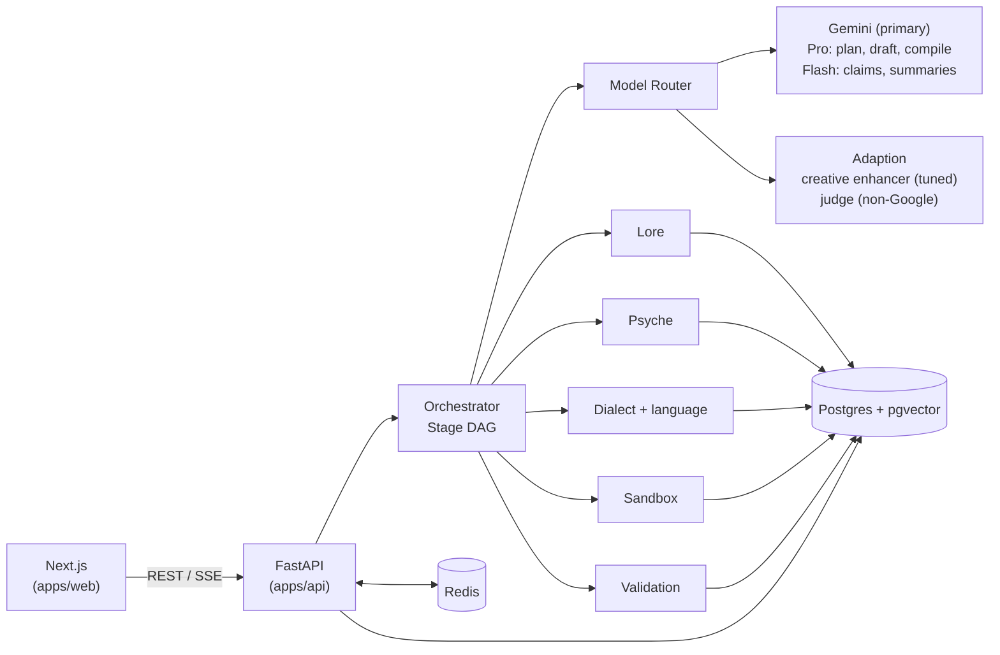

# ChronicleDeck

> Fiction authors lose track of their own world as a story grows, and AI writing tools make it worse by inventing contradictions with total confidence. ChronicleDeck treats the story bible as typed, versioned canon and checks every chapter against it, with evidence.

**Status: pre-build.** The app shell, data model, auth/CRUD API and eight mock screens exist. The generation pipeline, engines, prompts and evals are built during the live window. [PREBUILT.md](PREBUILT.md) lists exactly what is where.

---

## ❓ Problem Statement

**Problem:** Long-form fiction (novels, series, screenplays, game lore) accumulates thousands of facts: who is dead, who knows what, what a character would never do, how a faction talks, which words exist in an invented language. Authors keep these in their heads or scattered notes. LLM co-writers have no durable memory of them, so they quietly break canon: a dead character acts, a sworn enemy turns warm for no reason, a constructed language grows words that were never defined. Today the author finds these by rereading, usually after readers do.

**Why it matters:**
- Continuity errors are the most common reason a long draft needs a costly rewrite.
- Generic LLM output is fluent enough that the errors are easy to miss and hard to trace back.
- Authors will not adopt a tool that blocks their writing, buries them in JSON, or flags things it can't justify.

**Track:** Storytelling & Co-Writers

---

## 💡 Proposed Solution

**Solution:** A narrative intelligence studio that works in any genre, any universe and any invented language. Authors write (or co-write with the model) in an editor; every chapter is checked against their canon, and each warning points to the exact text and the exact canon it conflicts with.

**Key idea:** **Canon as code.** The story bible is typed, versioned data (entities, facts, rules, psychology, dialect, lexicon, per-branch state). Generated text is *linted* against it the way source code is linted: claims are extracted, checked by deterministic code where possible and by a different model family where not, and every flag must carry quoted evidence that is verified in code before the author ever sees it. Generated content can only create *proposals*; nothing becomes canon until the author approves it.

**Why this works:**
- **Evidence or it doesn't ship.** A flag with no evidence, or whose quotes don't match their sources exactly, is dropped. This is what keeps the lint trustworthy enough to leave on.
- **Deterministic where possible.** Closed-lexicon conlang checks, timeline rules, psychology transition limits and NPC knowledge scoping are code, so they can't hallucinate and can be tested.
- **Cross-family judging.** Gemini writes; a non-Google model hosted on Adaption judges, so the judge doesn't share the generator's blind spots.
- **Creative without losing canon.** A creative enhancer (a model fine-tuned with Adaption) rewrites Gemini's draft for voice and imagery, but its output is treated as untrusted and goes through every check afterwards. If it breaks canon, the plain draft is used.
- **Branches stay separate.** Every fork is its own timeline with its own snapshots, so "what if" comparisons are a diff, not a guess.
- **Flag, never block.** Authors keep control: strictness changes what is surfaced, one click marks a flag *Intentional*, and that choice is remembered.

---

## 🧩 Approach & Architecture

### System



### Per-scene pipeline

```
assemble_working_memory (5 slots)
  └─► plan_beats ─► validate_plan (canon refs exist, motives fit psyche, NPC knowledge scope)
        └─► generate (Gemini, stream) ─► creative_enhance (Adaption) ─► enhance_guard (code)
              └─► dialect_transduce ─► extract_claims ─┬─► lore_check
                                  ├─► psyche_check
                                  ├─► language_gate        ─► verify_evidence ─► aggregate
                                  └─► voice_check                                  └─► repair(spans) ≤2
                                                                                        └─► propose_canon ─► author_review ─► commit
```

Every stage validates its input and output schema, retries with the error fed back, post-validates semantically in code, and logs a trace (tokens per memory slot, cache hits, latency, cost).

### Memory: five types

| Type | Stores | Retrieval |
|---|---|---|
| **Global** | World rules, history, geography, languages | Cached canon prefix |
| **Character** | Psyche, relationships, voice/dialect | Entities named in the plan |
| **Branch** | Choices and state per timeline | Ancestry via recursive CTE |
| **Episodic** | Past events and summaries (saga → arc → chapter → scene) | Top-down vector search |
| **Working** | The context for one call | Built fresh, with a token budget per slot |

### Four engines

| Engine | What it does | How |
|---|---|---|
| **Lore** | Canon compiler, branch-scoped truth, timeline checks | Gemini Pro compiles notes into proposals; code enforces "dead characters can't act", "one place per scene" |
| **Psyche** | Keeps characters in character | Transition rules in code (e.g. trust can't jump more than 0.3 per chapter without a declared major event); judge with evidence |
| **Dialect + language** | Per-character voice and invented languages | Deterministic rewrite-rule transducer; closed lexicon, so any unknown conlang word is a hard flag; phonotactics FSM validates new words |
| **Sandbox** | NPCs that respect the world | Spawner anchors backstory to existing IDs; knowledge scoping flags "knowledge leaks" |

### Creative enhancer (Adaption)

Gemini drafts the scene from the plan; the enhancer rewrites it to be more vivid and less generic. Because a creative model is also more likely to invent things, it is boxed in:

- It runs **before** the checks, so its output is linted like any other generated text.
- `enhance_guard` (plain code) rejects a rewrite that drops planned beats or canon references, adds named entities that aren't in the plan, adds invented-language words outside the lexicon, or changes length wildly. A rejected passage falls back to Gemini's draft.
- The author sets **Creativity: Plain / Subtle / Bold**. Plain skips the stage.
- **Status:** no model is fine-tuned yet. The plan, constraints from Adaption's docs, and open questions (notably, how a tuned model gets served) are in [docs/creative-model.md](docs/creative-model.md). Until a model is configured the stage is skipped.

### Ten hallucination defences (each one measured)

| # | Defence | Enforced by |
|---|---|---|
| 1 | Plan before prose | New elements must be declared up front |
| 2 | Reference integrity | Every canon ref checked against the DB |
| 3 | Claim extraction | Prose broken into atomic claims |
| 4 | Cross-family judge | Gemini generates, a non-Google model judges |
| 5 | Evidence required | Flags without evidence are dropped |
| 6 | Exact-quote verification | Trigger and evidence quotes must match their sources exactly, checked in code |
| 7 | Deterministic gates | Conlang, timeline, psyche delta, knowledge scope |
| 8 | Span-level repair | At most 2 tries, then handed to the author |
| 9 | Canon ledger | Generated content only creates proposals |
| 10 | Exception memory | "Intentional" becomes a stored exception rule |

### Branching and What-if

Fork any chapter into a new timeline. Compare two branches side by side: a world diff, a relationship grid sorted by divergence, and overlaid psychology arcs with the fork marked. Every row links back to the chapter where the change happened.

### Author experience

No JSON or prompts in the UI, no blocking modals, a three-level strictness control, and **Fix / Intentional / Change rule** on every flag. Write-first onboarding: dump any notes or a manuscript and approve the resulting bible cards one at a time.

---

## 📁 Project Structure

```
apps/web/       Next.js 15 + Tailwind. 8 screens, mock data
apps/api/       FastAPI, SQLAlchemy 2 (async), Alembic migrations, auth, CRUD
pipeline/       Stage contract, model router, stages, prompts          ← built live
engines/        lore · psyche · dialect · language · sandbox           ← built live
memory/         memory tree, retriever, branch ancestry                ← built live
universes/      seed universes                                         ← built live (needs confirmation)
evals/          eval suites + harness                                  ← built live
tests/          unit (pre-built) · integration · e2e
docs/           architecture, memory model, ADRs, demo script, user guide
infra/          docker-compose + Dockerfiles
.github/        CI workflow
PREBUILT.md     every file committed before the live window
```

The screens (all written for authors, not engineers):

| Page | Route | What it is |
|---|---|---|
| Home | `/` | Hero, how it works, features, call-to-action |
| Start a story | `/start` | Title, paste notes or upload a file |
| Write | `/write` | Editor with notes on anything that doesn't fit, each with the reason; "Fix this", "Keep as is"; writing style and how closely to check |
| Screenplay | `/screenplay` | Script format with preview |
| Story bible | `/bible` | Characters, places, rules, languages, groups, side characters: approve, edit or remove |
| Storylines | `/storylines` | Map of every path the story has taken, coloured by how well each chapter fits |
| Compare | `/compare` | Two storylines side by side: world changes, trust between characters, a chapter-by-chapter chart |
| Suggestions | `/suggestions` | New characters, words and facts waiting for approval |
| Story health | `/health` | Consistency, check time and cost, what the assistant reads at each step |

### Design system

- **Palette:** cream `#f2e8da` is the page colour; brown `#3b2418` is the text and the main button colour. Everything else is a lighter or darker step of those two, plus four muted status colours. Dark mode swaps them (deep brown page, cream text and buttons).
- **Type:** two families only: Lora (headings, and your story's text) and Inter (everything else). Body text is 17px; nothing readable is set below 14px.
- **Theme toggle:** follows the system setting on first visit, remembers your choice, and applies before the page paints so there is no flash.
- **Motion:** short fades and lifts, using only opacity and transform; disabled for people who ask their system for reduced motion.
- **States:** every screen has a loading skeleton and, where it can be empty, a written empty state with a next step.
- **Language:** screens use everyday words ("notes", "story bible", "storylines", "suggestions"), never internal terms.
- **Accessibility:** every text and status colour pair meets WCAG AA contrast (4.5:1) in both themes (body text on cream is about 12:1), skip link, visible focus rings, labelled controls, tables with captions, no horizontal scroll at phone width.

---

## 🚀 How to Run

Python work happens in a project-local virtual environment.

```bash
python -m venv .venv
# Windows PowerShell: .\.venv\Scripts\Activate.ps1      macOS/Linux: source .venv/bin/activate
pip install -e ".[dev]"
npm --prefix apps/web install
cp .env.example .env     # model keys (GEMINI_API_KEY, ADAPTION_API_KEY) are only needed from the live build on
```

**Run the checks** (no database needed):

```bash
pytest && ruff check . && mypy
npm --prefix apps/web run lint && npm --prefix apps/web run typecheck
```

**Run the UI** (uses mock data, no backend needed):

```bash
npm --prefix apps/web run dev        # http://localhost:3000
```

**Run the full stack** (needs Docker):

```bash
make dev                             # db + redis + api + worker + web
```

Or run Postgres and Redis in Docker and the apps on the host: `make dev-deps`, `make migrate`, `make api`, `make web`. `make` is optional; each target is a one-line command you can paste.

**API docs:** `http://localhost:8000/docs`. Routes tagged `live-build` return `501` until they are built.

> `make eval`, `make seed` and `make demo` intentionally exit with a "built live" message in the pre-build.

---

## Planned Stack

| Layer | Technology | Why |
|---|---|---|
| Framework (web) | Next.js 15 (App Router), TypeScript, Tailwind, shadcn-style UI | Fast to build, server rendering, consistent components |
| Framework (api) | FastAPI, Python 3.12, Pydantic v2 | Async, schemas double as structured-output contracts |
| Editor / viz | TipTap (inline lint decorations), React Flow (branch map), Recharts | Squiggles and gloss tooltips in the text; DAG and charts |
| Database | Postgres 16 + pgvector | Relational canon and vector memory in one store, with branch-filtered search |
| Jobs / realtime | Arq + Redis, Server-Sent Events | Background compile/embed/audit; streaming generation |
| Primary model | Gemini Pro (planning, drafting, canon compile, repairs), Gemini Flash (claim extraction, summaries, NPC ticks) | One main model family; Gemini context caching on the canon prefix |
| Creative enhancer | Model fine-tuned with Adaption (Adaptive Data + AutoScientist), not trained yet | More creative prose than a general model; boxed in by `enhance_guard` and the checks |
| Judging | Non-Google model on Adaption's API (`qwen3.5-397b`, fallback `deepseek-v4-flash`) | A different family from the generator; same SDK as the enhancer |
| Provider SDKs | `google-genai`, `adaption` (Python) | Listed in the `llm` extra; nothing calls them until the live build |
| Auth | Email + password (scrypt) with JWT | Simple and sufficient; built into the pre-built API |
| Hosting | Vercel (web), Railway (api, worker), Neon (Postgres), Upstash or Railway Redis | Quick public URL |
| Observability | Langfuse + structlog | Traces, cost, tokens per memory slot |
| Quality | ruff, mypy (strict), ESLint, pytest, Hypothesis, GitHub Actions | Typed, tested, CI-gated |

---

## What We'll be Building Toward

**Already in the repo (pre-build):** app shell and 8 mock screens; TipTap lint-decoration hook; typed schema and migration for 22 tables including a pgvector index; auth and CRUD; the full route contract for the live endpoints (declared, returning 501); Docker, CI, docs and ADRs.

**Built live :**

 Model router and adapters, Stage contract, tracing, claim and verdict prompts, psyche transition rules, canon compiler, lore check, exact-quote verifier, conlang gate 
 Memory tree and working-memory slots, non-Google judges and evidence gate, dialect transducer, streaming editor with live lint, planner and Gemini generator with caching, creative enhancer stage and `enhance_guard`, repair loop, NPC spawner, evidence cards 
 Forking, snapshots and deltas, proposals and exceptions, voice judge and screenplay register, compare API and What-if, sandbox tick, cost panel with real data, eval runs, hardening, deploy 

**Evaluation plan.** 2–3 universes × 10 chapters × 2 branches with about 25 planted errors each (lore, psychology, timeline, voice, language, knowledge leak). Compare (A) raw Gemini with all lore pasted in, (B) the pipeline with Gemini judging Gemini, (C) the pipeline with a non-Google judge, and (D) run C plus the creative enhancer, plus ablations if time allows. Metrics: recall and precision per error type, residual errors per 1,000 words, evidence-validity rate, out-of-lexicon rate, cached-token share, cost and latency per chapter, and for D the violations the enhancer introduces per 1,000 words alongside a creativity preference score (enhanced vs plain draft). **No results exist yet**; `make eval` will write `evals/results.md`.

**Demo:** a three-minute "abandonment cascade" scenario showing a note with the reason behind it, a split storyline, and the side-by-side comparison.

**Stretch:** whole-branch long-context audit for slow character drift, live dialect ghost text, and a sandbox playground where dropping an event returns NPC reactions as proposals.

---

## Docs
[Architecture](docs/architecture.md) · [Memory model](docs/memory.md) · [Creative model plan](docs/creative-model.md) · [ADRs](docs/adr/) · [Adaption docs](https://docs.adaptionlabs.ai) · [Pre-built inventory](PREBUILT.md) · [Demo script](docs/demo-script.md) · [User guide](docs/user-guide.md)
