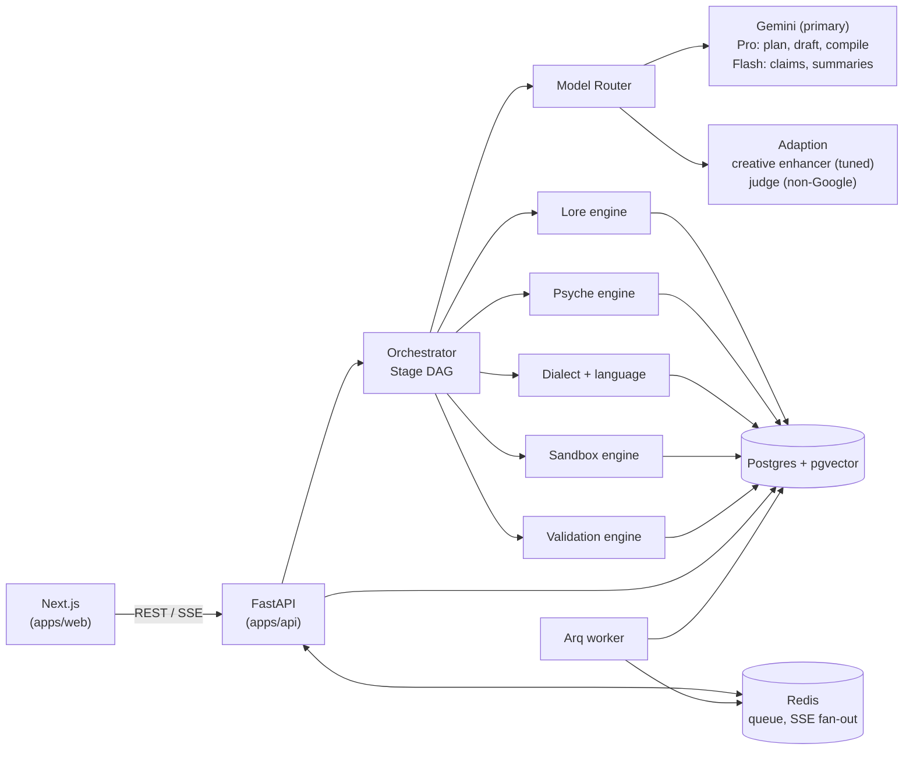
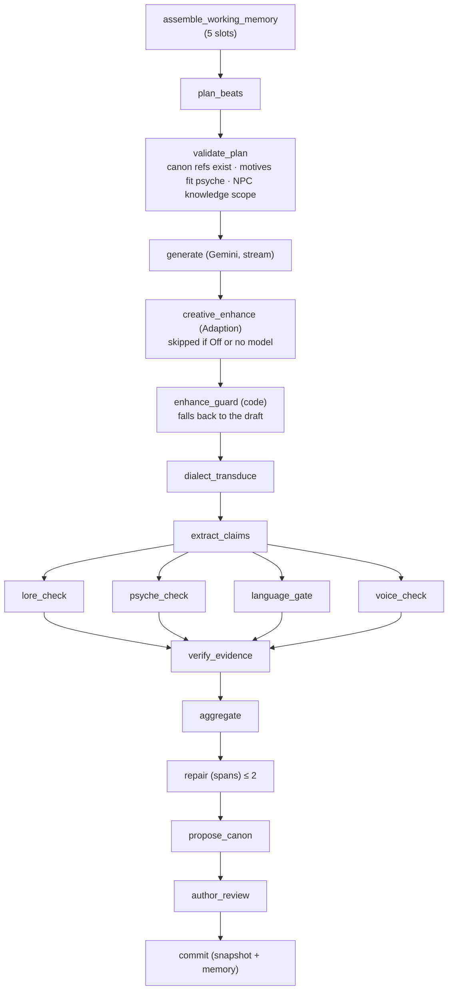

# Architecture

> Status: design. The shell, schema and CRUD are pre-built; everything inside the **Orchestrator**,
> **Model Router** and the five engines is built live.

## System

| Box | Where | Pre-built? |
|---|---|---|
| Next.js shell, 8 screens | `apps/web` | Yes, with mock data |
| FastAPI app, auth, CRUD | `apps/api` | Yes |
| Postgres + pgvector schema, migration | `apps/api/alembic`, `apps/api/app/models` | Yes |
| Orchestrator, router, adapters, Stage | `pipeline/core` | **Live** |
| Engines | `engines/*` | **Live** |
| Memory tree + retriever | `memory/` | **Live** |

## Per-scene pipeline (Stage DAG)

## Model roles

| Role | Model | Details |
|---|---|---|
| Primary | Gemini Pro | Planning, drafting, canon compile, hard repairs |
| Utility | Gemini Flash | Claim extraction, summaries, NPC ticks |
| Creative enhancer | Adaption-tuned model, **not trained yet** | Rewrites the draft for voice and imagery. Output is untrusted and checked afterwards ([ADR 0007](adr/0007-creative-enhancer-is-untrusted.md), [tuning plan](creative-model.md)) |
| Judge | Non-Google model on Adaption (`qwen3.5-397b`, fallback `deepseek-v4-flash`) | Verdicts with evidence ([ADR 0004](adr/0004-cross-family-judge.md)) |

Why these providers: [ADR 0006](adr/0006-gemini-primary-adaption-enhancer-and-judge.md).

## Where the pre-built API stops

`apps/api/app/routers/live.py` declares every endpoint the live build adds, each returning
`501 Built live: …`. That keeps the route contract (and OpenAPI) fixed from hour 0 so the frontend
and the pipeline can be built in parallel. A test (`tests/unit/test_api_smoke.py`) asserts that every
one of them is declared and honest about being unimplemented.

## Boundaries worth knowing

- **Ledger rule.** Proposals can be created and read through CRUD, never edited or deleted. Their
  accept/reject path (which materialises canon) is a live endpoint.
- **Branch scoping.** `fact.branch_scope IS NULL` means "all branches". Ancestry lookup is a live
  recursive CTE in `memory/`.
- **Circular FK.** `branch.fork_chapter_id → chapter.id` and `chapter.branch_id → branch.id`
  reference each other, so the migration adds the first FK after both tables exist.
