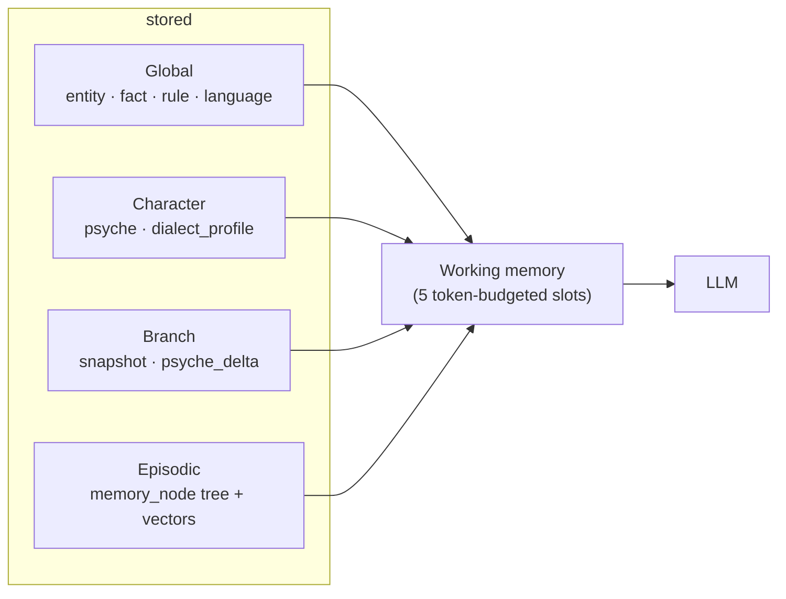

# Memory: the five-type taxonomy

| Type | Stores | Tables | Retrieval |
|---|---|---|---|
| **Global** | World rules, history, geography, languages | `entity`, `fact`, `constraint_rule`, `language`, `lexeme` | Cached canon prefix |
| **Character** | Psyche, relationships, voice/dialect | `psyche`, `dialect_profile` | Entities named in the plan |
| **Branch** | Choices and state per timeline | `branch`, `state_snapshot`, `psyche_delta`, branch-scoped `fact` | Ancestry via recursive CTE |
| **Episodic** | Past events, summaries | `memory_node` (saga → arc → chapter → scene) | Top-down vector search |
| **Working** | The context for this call | not stored | Built fresh, with a token budget per slot |

## Write path (live)
Accepted chapter → scene summaries → chapter rollup → arc rollup → saga update → embed → snapshot.

## Read path (live)
Saga → top-k arcs → top-k chapters → top-k scenes, filtered by branch ancestry.

## What the pre-build provides
Only storage: the tables above, `vector(1536)` on `memory_node.embedding` with an HNSW cosine index,
and CRUD for the global and character types. The tree logic, retrieval and slot budgeting are built live.
